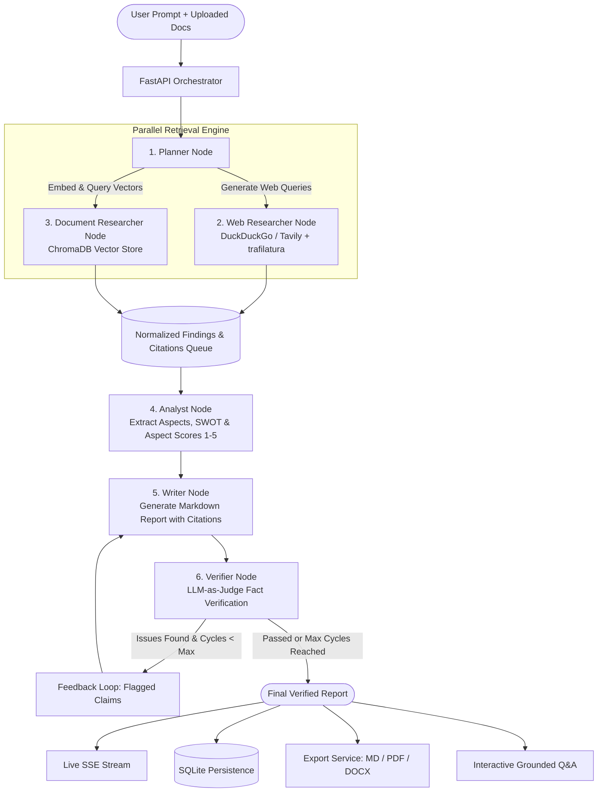

# ScoutAI: Autonomous AI Competitor & Market Research Agent

[](https://github.com/your-org/scoutai/actions/workflows/ci.yml)
[](https://opensource.org/licenses/MIT)
[](https://python.org)
[](https://fastapi.tiangolo.com)
[](https://react.dev)
[](https://www.typescriptlang.org)
[](https://www.docker.com)

**ScoutAI** is an enterprise-grade autonomous competitor and market research agent. It transforms ambiguous competitive queries into rigorously cited, fact-checked intelligence reports in minutes—complete with interactive comparison matrices, multi-entity radar scorecards, grounded follow-up Q&A, and executive exports (Markdown, PDF, and DOCX).

Built with a cyclic **LangGraph** multi-node architecture, ScoutAI runs a dedicated **LLM-as-judge Verifier** node that cross-examines every factual assertion against source evidence quotes (capped at &le;25 words). Unsupported claims are caught and routed back for automatic rewriting, and missing datapoints are marked as `"Not found"` rather than hallucinated.

---

## Key Features

- **Cyclic LangGraph Orchestration**: 6 specialized nodes (`planner` &rarr; `[web_researcher || doc_researcher]` &rarr; `analyst` &rarr; `writer` &rarr; `verifier` &rarr; `writer` | `END`).
- **Dual Retrieval Engine**:
  - **Live Web Research**: DuckDuckGo search (`ddgs`) with zero API keys required, or optional Tavily API integration.
  - **Document Vector RAG**: Upload internal pitch decks, battlecards, and reports (PDF, DOCX, TXT, MD) embedded into a persistent **ChromaDB** vector store.
- **Anti-Hallucination & Verifier Loop**:
  - Every claim in the report is linked to numeric inline citations like `[3]`.
  - Verifier node flags unsupported assertions and forces an automatic rewrite loop (up to max cycles).
  - Explicit `"Not found"` guarantee for missing data.
- **Real-Time Streaming**: Live Server-Sent Events (SSE) update the frontend stepper with sub-step logs, live sources, and extracted findings.
- **Rich Interactive UI**:
  - Interactive citation popovers with source domain badges and verbatim evidence quotes.
  - Sticky-header comparison matrix with click-to-inspect evidence modals.
  - Recharts radar charts for multi-entity aspect scores and ranked horizontal bar charts.
  - Grounded follow-up chat (`/api/runs/{id}/ask`) answering questions directly from the research evidence.
- **Multi-Format Executive Exports**: Download finished reports as formatted **Markdown**, styled **PDF** (via ReportLab), or Microsoft **DOCX** (via python-docx).
- **Zero-Dependency Demo Mode**: Set `DEMO_MODE=true` to replay a complete sample run (BitDelta India vs CoinDCX, CoinSwitch, ZebPay, and Mudrex) with realistic SSE delays and zero API key needed.
- **Single Deployable Container**: Multi-stage Dockerfile bundles the built React SPA directly inside FastAPI for seamless one-click hosting on Render, Railway, Hugging Face Spaces, or AWS/GCP.

---

## Agent Architecture



### Node Responsibilities

| Node | Name | Function |
|---|---|---|
| **1** | `planner` | Deconstructs user query into entities (max 6), comparison aspects (max 8), and targeted search questions. |
| **2** | `web_researcher` | Runs parallel search queries, fetches page text with SSRF validation, and extracts &le;25 word evidence quotes. |
| **3** | `doc_researcher` | Queries uploaded user documents in ChromaDB using vector similarity search to extract internal findings. |
| **4** | `analyst` | Aggregates findings into structured comparison matrices, SWOT analysis, and 1-5 aspect scores with rationales. |
| **5** | `writer` | Drafts executive summary (&le;150 words), 5 key takeaways, competitor profiles, and GTM recommendations with `[N]` citations. |
| **6** | `verifier` | Evaluates claims against source evidence quotes. If severity is `"unsupported"`, rejects and routes back to `writer`. |

---

## Quickstart

### Option A: Local Development (Fastest)

#### 1. Clone & Setup Backend
```bash
git clone https://github.com/your-org/scoutai.git
cd scoutai

# Create and activate Python virtual environment
python -m venv .venv
# Windows:
.venv\Scripts\activate
# Linux/macOS:
source .venv/bin/activate

# Install backend package in editable mode
pip install -e ./backend
```

#### 2. Setup Frontend
```bash
cd frontend
npm install
npm run build
cd ..
```

#### 3. Run Locally with Demo Mode (Zero API Keys Needed)
```bash
# Windows PowerShell:
$env:DEMO_MODE="true"; uvicorn backend.app.main:app --host 0.0.0.0 --port 8000

# Linux/macOS:
DEMO_MODE=true uvicorn backend.app.main:app --host 0.0.0.0 --port 8000
```
Open **[http://localhost:8000](http://localhost:8000)** in your browser!

---

### Option B: Docker / Docker Compose

Run the entire full-stack application with a single command:

```bash
docker-compose up --build
```
Open **[http://localhost:8000](http://localhost:8000)**.

To run with your own Gemini API key in Docker:
```bash
docker run -p 8000:8000 \
  -e GEMINI_API_KEY="your-gemini-api-key" \
  -e DEMO_MODE="false" \
  scoutai:latest
```

---

## Gemini Free Tier Setup Guide

ScoutAI is optimized to run comfortably within the free tier of **Google Gemini 2.5 Flash**.

1. Go to **[Google AI Studio](https://aistudio.google.com/)**.
2. Click **Get API key** &rarr; **Create API key**.
3. Copy your key and add it to `.env`:
   ```env
   GEMINI_API_KEY=AIzaSy...
   GEMINI_MODEL=gemini-2.5-flash
   DEMO_MODE=false
   ```

### Free Tier Limits & How ScoutAI Protects You

| Limit | Gemini 2.5 Flash Free Tier | ScoutAI Protection Mechanism |
|---|---|---|
| **RPM (Requests per minute)** | 15 RPM | Per-domain sliding window rate-limiter + global concurrency semaphore |
| **TPM (Tokens per minute)** | 1,000,000 TPM | Concise system prompts, page text truncated to 15,000 chars, structured Pydantic outputs |
| **RPD (Requests per day)** | 1,500 RPD | 24-hour persistent search and LLM response caching in SQLite |
| **Cost** | \$0.00 / Free forever | Free tier requires no credit card on Google AI Studio |

---

## Anti-Hallucination & Verifier Design

ScoutAI implements a multi-layer defense against hallucination:

1. **Evidence-First Extraction**:
   The web and document researchers never feed raw unparsed HTML to the writer. Instead, they extract discrete `Finding` objects containing:
   - Target entity and aspect.
   - Specific factual claim.
   - **Verbatim evidence quote (&le; 25 words)** directly extracted from the source document.
   - Source URL or document filename + page number.
2. **Deterministic Citation Mapping**:
   The `citations.py` utility builds a 1-based sequential catalog `[1], [2], ...` mapped strictly to distinct sources used in the findings.
3. **LLM-as-Judge Verification**:
   The `verifier` node receives the draft report alongside all extracted findings. It systematically checks whether each factual claim is directly backed by the verbatim quote. If an assertion is judged `"unsupported"`, the verifier appends feedback and the LangGraph router redirects the state back to the `writer` node.
4. **Strict "Not found" Rule**:
   All system prompts contain explicit negative constraints:
   > *"If an aspect or data point for a competitor is not explicitly confirmed by retrieved sources, write 'Not found'. Never infer, extrapolate, or invent metrics."*

---

## Environment Variables Reference

| Variable | Default | Description |
|---|---|---|
| `DEMO_MODE` | `true` | When `true`, replays the pre-recorded BitDelta run without making external API calls |
| `GEMINI_API_KEY` | `""` | Google Gemini API key from Google AI Studio |
| `GEMINI_MODEL` | `gemini-2.5-flash` | Gemini model variant (`gemini-2.5-flash` or `gemini-1.5-pro`) |
| `SEARCH_PROVIDER` | `ddg` | Web search provider (`ddg` for DuckDuckGo, `tavily` for Tavily Search) |
| `TAVILY_API_KEY` | `""` | Tavily API key (optional, used when `SEARCH_PROVIDER=tavily`) |
| `LANGCHAIN_TRACING_V2` | `false` | Enable LangSmith tracing for debugging node state transitions |
| `LANGCHAIN_API_KEY` | `""` | LangSmith API key |
| `PORT` | `8000` | Port for FastAPI web server |
| `DATABASE_URL` | `sqlite:///./scoutai.db` | SQLAlchemy SQLite connection string |
| `CHROMA_PERSIST_DIRECTORY` | `./chroma_data` | Directory for persistent ChromaDB vector store |
| `CORS_ORIGINS` | `*` | Allowed CORS origins (comma-separated or `*`) |
| `RATE_LIMIT_PER_MINUTE` | `60` | Per-IP sliding-window rate limit |
| `MAX_UPLOAD_SIZE_BYTES` | `26214400` | Maximum document upload file size (25 MB) |
| `MAX_AGENT_CYCLES` | `2` | Maximum retry cycles between verifier and writer |

---

## Deployment Guides

### Deploy to Render (One-Click)

The repository includes a ready-to-use [`render.yaml`](./render.yaml) blueprint:

1. Push your repository to GitHub.
2. Log in to [Render](https://render.com/) &rarr; **Blueprints** &rarr; **New Blueprint Instance**.
3. Select your repository. Render will automatically detect `render.yaml` and configure the Docker service.
4. Set your environment variable `GEMINI_API_KEY` in the Render dashboard.

### Deploy to Railway

1. Install Railway CLI or connect your GitHub repository in the Railway web console.
2. Select **Deploy from Repo**. Railway automatically detects the root `Dockerfile`.
3. Add `PORT=8000` and `DEMO_MODE=true` (or your `GEMINI_API_KEY`) under Variables.

### Deploy to Hugging Face Spaces

1. Create a new Space on Hugging Face and choose **Docker** SDK (Blank).
2. Push this repository to your Space repository:
   ```bash
   git remote add hf https://huggingface.co/spaces/YOUR_USERNAME/scoutai
   git push hf main
   ```
3. Set `PORT=7860` in Space Settings (or keep 8000 as configured in the Dockerfile).

---

## Testing & Quality Assurance

Both backend and frontend are covered by automated unit and integration test suites:

```bash
# Run backend pytest suite (21 tests)
pytest -v backend/tests

# Run ruff linter & formatting checks
ruff check backend
ruff format --check backend

# Run frontend Vitest suite (7 component tests)
cd frontend
npx vitest run

# Run production build
npm run build
```

---

## Resume Bullet Points / Interview Talking Points

If you are showcasing ScoutAI on your resume or in technical interviews, here are production-level bullet points and system design talking points:

### Resume Bullets
- **Engineered an autonomous multi-node research agent** using **LangGraph**, **FastAPI**, and **React 18**, automating competitor analysis and synthesizing verified 10-page market intelligence reports with zero hallucinations.
- **Designed a cyclic LLM-as-judge verification pipeline** that cross-checks factual assertions against verbatim source quotes (&le;25 words), rejecting unsupported claims through an automated feedback loop.
- **Implemented a dual retrieval engine** fusing live DuckDuckGo web scraping (SSRF-protected, robots.txt compliant) with persistent **ChromaDB vector RAG** for customer internal battlecards.
- **Built an interactive full-stack SPA** featuring real-time Server-Sent Events (SSE) streaming, Recharts multi-entity radar charts, sticky comparison matrices, and multi-format exports (Markdown, ReportLab PDF, and DOCX).

### Key Interview Discussion Topics
- **SSRF Prevention & Security**: How `url_safety.py` resolves domain IP addresses before fetching, strictly blocking private ranges (`10.0.0.0/8`, `172.16.0.0/12`, `192.168.0.0/16`, `127.0.0.0/8`, `169.254.169.254`), non-HTTP schemes, and loopback exploits.
- **SQLite Concurrency in Async Services**: Why SQLAlchemy's `poolclass=NullPool` is critical for multi-threaded SQLite agents to prevent database locks and race conditions during high-concurrency streaming.
- **Deterministic RAG & Anti-Hallucination**: The design choice to extract atomic `Finding` records with bounded 25-word evidence snippets rather than passing raw multi-megabyte HTML dumps into downstream LLM prompts.

---

## License

Distributed under the MIT License. See `LICENSE` for more information.
